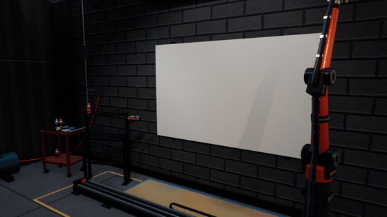

# SprayBot

A 3D industrial mural-painting robot simulator and offline video renderer built with Rust and Bevy. Give it an SVG and a 7-DOF rail-mounted robot arm picks up matching aerosol cans, shakes them, and sprays the artwork onto a wall canvas.



## Build

Requires **Rust 1.85+** (Edition 2024), a Vulkan-capable GPU driver, and `ffmpeg` (optional, for MP4/MKV/MOV video export).

### Fedora (DNF)

```bash
sudo dnf install gcc pkgconf-pkg-config rust cargo vulkan-loader mesa-vulkan-drivers ffmpeg-free
cargo build --release
```

### Ubuntu / Debian (APT)

```bash
sudo apt update
sudo apt install -y build-essential pkg-config curl libvulkan1 mesa-vulkan-drivers libxkbcommon0 ffmpeg
curl --proto '=https' --tlsv1.2 -sSf https://sh.rustup.rs | sh
cargo build --release
```

*(If your distro's `rustc` package is older than 1.85, install Rust via `rustup`.)*

## Live View

Launch the interactive 3D viewport using the built-in showcase SVG (`assets/examples/02_street_art_poster.svg`):

```bash
cargo run --release
```

Or load a custom SVG at 4x playback speed:

```bash
cargo run --release -- assets/examples/01_geometric_shapes.svg --speed 4
```

**Controls:** Left-drag to orbit, Right/Middle-drag to pan, scroll to zoom, `1`–`4` for camera presets (`overview`, `follow`, `rack`, `canvas`), `Space` to pause, `[` / `]` to adjust speed, `G` for toolpath gizmos, `H` to toggle HUD, `R` to reset, `Q` / `Esc` to quit.

## Offline Recording

Render a deterministic fixed-timestep video without opening a window using `--headless` and `--record`:

```bash
cargo run --release -- assets/examples/01_geometric_shapes.svg \
  --headless --record out.mp4 --fps 60 --resolution 1920x1080 --speed 4
```

To export a PNG image sequence instead of a video (no `ffmpeg` required), pass a directory path:

```bash
cargo run --release -- --headless --record renders/frames --fps 30
```

Run `cargo run --release -- --help` for all CLI options (`--camera`, `--canvas-res`, `--max-cans`, `--seed`).

## License

[MIT](LICENSE)
